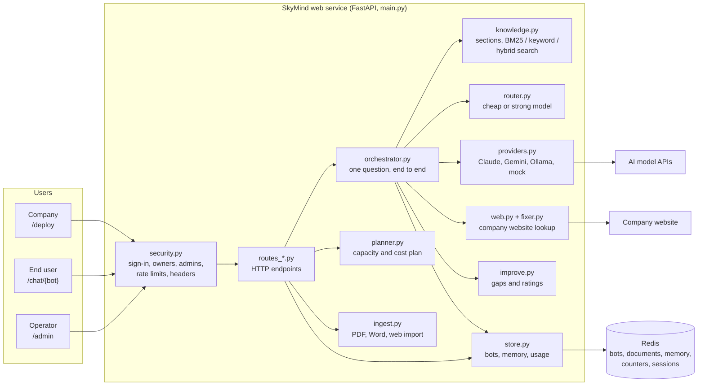
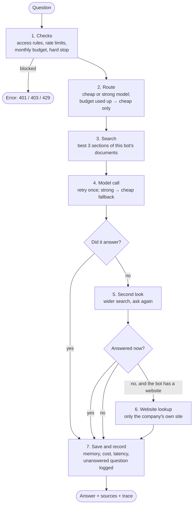

# SkyMind architecture

## The pieces

## What happens to one question

Every answer carries a `trace` with the time each step took, and the chat page shows it under "How this answer was made".

## Where it runs

- **Locally:** `docker compose up --build` starts SkyMind and Redis. Redis is never published outside the containers.
- **On Render:** `render.yaml` creates the web service and a private Redis. `SEED_EXAMPLES` re-creates the sample bots on every start, because the free Redis is wiped on restart. `TRUSTED_PROXY_HOPS` tells SkyMind which `X-Forwarded-For` entry is the real visitor.
